# Guía paso a paso — Taller U2 (AA2): scripts automatizados del módulo completo

| Campo | Valor |
|---|---|
| **Actividad** | AA2 — Taller grupal: scripts automatizados funcionales |
| **Integrante** | Jhon Alexis Moreno |
| **Roles asumidos** | Líder/integrador · Responsable de API · Responsable de interfaz · Responsable de evidencias y documentación |
| **Módulo** | Mini aplicación **"Inscripciones CETO"** (Opción A) |
| **Foco asignado** | **1. Ciclo de vida del registro:** crear (web y API) → consultar → listar → eliminar → verificar que ya no existe |
| **Suite** | 37 pruebas automatizadas: 20 API · 11 interfaz · **6 flujos E2E** |
| **Herramientas** | Python 3.15.2 · pytest 9.2.0 · requests 2.34.2 · Selenium 4.52.0 · pytest-html 4.2.0 · Flask 3.1.3 · Git 2.56.1 · Chrome (headless) |
| **Fecha** | 10 de noviembre de 2026 |

---

## 1. Portada: equipo, roles y foco

El trabajo se organizó con los **cuatro roles** del Paso 1 del documento. Por
condiciones del curso el equipo funcionó como **integrante único**, asumiendo
todas las responsabilidades (el documento permite que en equipos pequeños el
líder asuma además la documentación); los **responsables de la matriz de casos**
reflejan el rol bajo el cual se escribió cada prueba, no a personas distintas.

| Rol | Responsabilidad principal | Quién lo asumió |
|---|---|---|
| **Líder / integrador** | Repositorio, plan de pruebas, integración del código, pipeline | Jhon Moreno |
| **Responsable de API** | Pruebas de la API REST (requests) | Jhon Moreno |
| **Responsable de interfaz** | Page Objects y pruebas Selenium | Jhon Moreno |
| **Responsable de evidencias y documentación** | Capturas, reporte, guía paso a paso, reflexión | Jhon Moreno |

**Foco 1 — Ciclo de vida del registro.** Todo el módulo se probó desde esa
óptica: un estudiante se **crea** por el formulario o por la API, se **consulta**
por id, aparece en los **listados** (web y API), se **elimina** y, después de
borrarse, **ya no existe** en ninguna capa y su correo vuelve a estar libre.

---

## 2. Módulo bajo prueba y herramientas

### 2.1 La aplicación

Sistema Flask con datos en memoria (se pierden al reiniciar, ideal para pruebas):

| Capa | Ruta | Qué hace |
|---|---|---|
| API REST | `GET/POST /api/estudiantes` | Lista (con `?programa=`) y crea estudiantes en JSON |
| API REST | `GET/DELETE /api/estudiantes/<id>` | Consulta y elimina por id |
| Formulario | `/inscripcion` (GET/POST) | Inscripción web; muestra mensaje `EST-XXXX` o errores por campo |
| Listado | `/estudiantes` | Tabla con código, nombre, correo, programa, semestre y contador `#total` |

Reglas de negocio (contrato): nombre ≥ 3 caracteres · correo válido y único ·
programa en la lista permitida · semestre entre 1 y 10. El POST del formulario
tiene **0,5 s de latencia simulada**, lo que obliga a esperas explícitas.

Códigos: `201` creación · `400` cuerpo no JSON · `409` correo duplicado ·
`422` datos inválidos · `204` borrado · `404` no encontrado.

### 2.2 Estructura del repositorio y reparto

```
tests/conftest.py                     ← fixtures compartidas (NO se modifica sin avisar)
tests/test_api_estudiantes.py         ← responsable de API (20 pruebas, marca `api`)
tests/test_formulario_inscripcion.py  ← responsable de interfaz (11 pruebas, marca `ui`)
tests/test_flujo_e2e.py               ← entre todos (6 flujos, marcas `ui` + `e2e`)
pages/inscripcion_page.py             ← Page Object del formulario (marca `ui`)
pages/listado_page.py                 ← Page Object del listado (marca `ui`)
data/casos_formulario.csv             ← datos de prueba parametrizados
app/                                  ← aplicación bajo prueba (no se modifica en pruebas)
.github/workflows/pruebas.yml         ← pipeline de CI (líder)
capturas/ · evidencias/ · reportes/   ← evidencias
GUIA_AA2.md · GUIA_AA2.html           ← esta guía
```

Marcos registrados en `pytest.ini` (`api`, `ui`, `e2e`), tal como exige el Paso 5.

---

## 3. Plan de pruebas del módulo (Paso 3)

Se definió **antes de programar**, ampliando las matrices individuales de AA1.

### 3.1 Historias / funcionalidades

- **H1.** Como coordinador quiero **inscribir estudiantes por el formulario** para registrarlos y recibir un código.
- **H2.** Como sistema quiero **crear estudiantes vía API** para integrarnos con otros módulos.
- **H3.** Como coordinador quiero **consultar y listar** los inscritos (por id, completos y filtrados) para verificar quiénes están registrados.
- **H4.** Como administrador quiero **eliminar inscripciones** para corregir errores, con la certeza de que el dato desaparezca en todas las capas.
- **H5.** Como sistema quiero **integridad de datos**: sin duplicados y con los mismos valores en web y API durante todo el ciclo de vida.

### 3.2 Matriz de casos (37 automatizados, con responsable y estado)

**Pruebas de API — 20 casos** · Responsable: *API*

| ID | Funcionalidad | Tipo | Datos | Resultado esperado | Responsable | Estado |
|---|---|---|---|---|---|---|
| API-01 | Crear estudiante válido | API | nombre "Carlos Andres Ruiz", correo único, semestre 5 | 201 + JSON con id ≥ 1 y los datos enviados | API | Aprobada |
| API-02 | Semestre en texto | API | semestre "7" | 201 y `semestre == 7` | API | Aprobada |
| API-03 | Persiste en el listado | API | POST y luego GET de la lista | 200 + la lista contiene el correo | API | Aprobada |
| API-04 | Cuerpo no JSON | API | texto plano | 400 + "El cuerpo debe ser JSON" | API | Aprobada |
| API-05 | Nombre corto (límite) | API | "Ab" | 422 + error en nombre | API | Aprobada |
| API-06 | Correo inválido | API | "correo-malo" | 422 + error en correo | API | Aprobada |
| API-07 | Programa inexistente | API | "Cocina" | 422 + error en programa | API | Aprobada |
| API-08 | Semestre bajo el límite | API | 0 | 422 + error en semestre | API | Aprobada |
| API-09 | Semestre sobre el límite | API | 11 | 422 + error en semestre | API | Aprobada |
| API-10 | Semestre no numérico | API | "abc" | 422 + error en semestre | API | Aprobada |
| API-11 | Varios errores a la vez | API | los 4 campos inválidos | 422 + los 4 campos en `errores` | API | Aprobada |
| API-12 | Correo duplicado | API | correo ya registrado | 409 + "El correo ya esta registrado" | API | Aprobada |
| API-13 | Listar estudiantes | API | — | 200 + lista (array) | API | Aprobada |
| API-14 | Filtrar por programa | API | `?programa=Ingenieria Industrial` | 200 + solo ese programa | API | Aprobada |
| API-15 | Consultar por id | API | id de un estudiante creado | 200 + los mismos datos | API | Aprobada |
| API-16 | Id inexistente | API | 999999 | 404 + "Estudiante no encontrado" | API | Aprobada |
| API-17 | Eliminar existente | API | id creado | 204 sin cuerpo; luego GET → 404 | API | Aprobada |
| API-18 | Eliminar inexistente | API | 888888 | 404 | API | Aprobada |
| **API-19** | **Ciclo de vida completo** (foco 1) | API | crear → consultar → listar → eliminar → verificar ausencia | cada paso deja el sistema en su estado esperado | API | Aprobada |
| **API-20** | **Borrado libera el correo** (foco 1) | API | crear, borrar y volver a crear el mismo correo | 201 en la segunda creación | API | Aprobada |

**Pruebas de interfaz — 11 casos** · Responsable: *Interfaz*

| ID | Funcionalidad | Tipo | Datos | Resultado esperado | Responsable | Estado |
|---|---|---|---|---|---|---|
| WEB-01 | Inscripción exitosa | web | datos válidos (correo único) | mensaje "Inscripcion exitosa. Codigo: EST-XXXX" | Interfaz | Aprobada |
| WEB-02 | Aparece en el listado | web | inscribir y navegar a /estudiantes | correo y nombre en la tabla | Interfaz | Aprobada |
| WEB-03 | Envío vacío | web | sin tocar nada | errores en los 4 campos | Interfaz | Aprobada |
| WEB-04 | Nombre corto | web | "Al" (CSV) | mensaje exacto SOLO bajo nombre | Interfaz | Aprobada |
| WEB-05 | Correo inválido | web | "luis-ceto.edu.co" (CSV) | mensaje exacto SOLO bajo correo | Interfaz | Aprobada |
| WEB-06 | Sin programa | web | opción por defecto (CSV) | mensaje exacto SOLO bajo programa | Interfaz | Aprobada |
| WEB-07 | Semestre 0 (límite) | web | 0 (CSV) | mensaje exacto SOLO bajo semestre | Interfaz | Aprobada |
| WEB-08 | Semestre 11 (límite) | web | 11 (CSV) | mensaje exacto SOLO bajo semestre | Interfaz | Aprobada |
| WEB-09 | Conserva datos tras el error | web | semestre 99 | error en semestre Y el nombre sigue escrito | Interfaz | Aprobada |
| WEB-10 | Correo duplicado por web | web | dos veces el mismo correo | "El correo ya esta registrado" | Interfaz | Aprobada |
| WEB-11 | Listado consistente | web | abrir /estudiantes | filas = contador `#total` y códigos `EST-XXXX` | Interfaz | Aprobada |

**Flujos de punta a punta — 6 casos (mínimo requerido: 3)** · Responsable: *Equipo (API + Interfaz)*

| ID | Funcionalidad | Tipo | Datos | Resultado esperado | Responsable | Estado |
|---|---|---|---|---|---|---|
| E2E-01 | Inscripción web → API | flujo E2E | formulario con correo único | el registro aparece en la API con nombre, programa y semestre idénticos | Equipo | Aprobada |
| E2E-02 | Creación API → listado web | flujo E2E | POST por API | el listado web muestra la fila con el código `EST-id` asignado por la API | Equipo | Aprobada |
| E2E-03 | Ciclo de vida completo desde la web (caso bandera) | flujo E2E | formulario → API → listado → DELETE | el código `EST-XXXX` corresponde al id de la API; tras borrar: 404 en API y fila ausente en el listado | Equipo | Aprobada |
| E2E-04 | Ciclo de vida completo desde la API | flujo E2E | POST → GET → listado → DELETE | consulta consistente con la creación; ausencia verificada en API **y** en la web | Equipo | Aprobada |
| E2E-05 | Duplicado web con verificación en API | flujo E2E | dos inscripciones con el mismo correo | el segundo intento muestra el error y la API conserva **un solo** registro | Equipo | Aprobada |
| E2E-06 | Reincorporación tras el borrado | flujo E2E | web → DELETE por API → web con el mismo correo | la reinscripción triunfa y queda exactamente un registro | Equipo | Aprobada |

### 3.3 Flujos de punta a punta (lo que diferencia AA2 de AA1)

| # | Flujo | Capa de inicio | Capa de verificación |
|---|---|---|---|
| 1 | Inscribo por el **formulario** → lo encuentro en la **API** | Web | API |
| 2 | Creo por la **API** → aparece en el **listado web** | API | Web |
| 3 | Inscribo dos veces el mismo correo por la **web** → el segundo intento muestra el error y la API conserva un solo registro | Web | API |
| 4 | **Ciclo de vida completo web**: código `EST-XXXX` ↔ id API ↔ listado ↔ borrado ↔ ausencia en ambas capas | Web + API | Ambas |
| 5 | **Ciclo de vida completo API** con verificación en el listado web | API | Web |
| 6 | Borrado por API → el correo se vuelve a inscribir por web | API | Web |

### 3.4 Criterio de terminado

- [x] Todas las pruebas pasan (`python -m pytest -v` en verde).
- [x] Evidencias generadas: capturas de navegador, salidas de terminal y reporte HTML.
- [x] **Sin `time.sleep`**: solo esperas explícitas (`WebDriverWait`) — verificado con búsqueda en el código.
- [x] La suite completa pasa **3 veces seguidas** (Paso 6).

---

## 4. Paso a paso del trabajo (reproducible por otro equipo)

### 4.1 Preparar el entorno

```bash
python -m venv .venv
.venv\Scripts\activate              # Windows (Linux/Mac: source .venv/bin/activate)
python -m pip install -r requirements.txt
python --version                    # 3.15.2
```

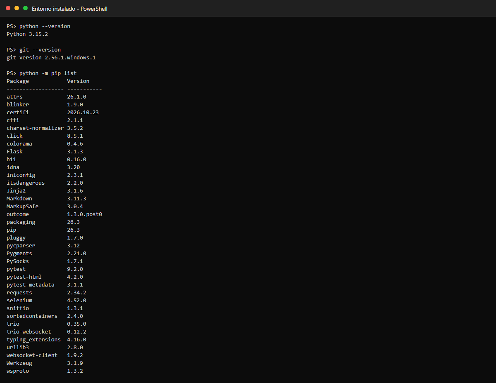

*Captura 1. Entorno instalado: versiones de Python y Git y paquetes de la suite.*

### 4.2 Explorar la aplicación a mano

```bash
python -m app.servidor              # http://127.0.0.1:5000/inscripcion
```

Se recorrieron el formulario, el listado y la API en el navegador (F12) para
levantar los identificadores (`#nombre`, `#btn-inscribir`, `#mensaje-exito`,
`#error-<campo>`, `#tabla-estudiantes`, `#total`) antes de escribir pruebas.

### 4.3 Montar el repositorio compartido (Paso 4)

```bash
git init
git add .
git commit -m "Proyecto base del taller grupal"
git branch -M main
```

Se creó un `.gitignore` que excluye `.venv/`, `__pycache__/` y el material de
la actividad individual: **el repositorio se entrega sin el entorno virtual**.

### 4.4 Trabajar por ramas (una por responsabilidad)

```bash
git checkout -b api-jhon             # rama del responsable de API
# ... tests/test_api_estudiantes.py: API-19 y API-20 (ciclo de vida) ...
git add tests/test_api_estudiantes.py
git commit -m "Pruebas API: ciclo de vida completo y liberacion de correo tras borrado"
git checkout main
git merge --no-ff api-jhon           # el líder integra

git checkout -b interfaz-jhon        # rama del responsable de interfaz
# ... pages/listado_page.py + WEB-11 ...
git commit -am "Page Object del listado y prueba de consistencia filas/contador"
git checkout main && git merge --no-ff interfaz-jhon

git checkout -b e2e-jhon             # flujos entre todos
# ... tests/test_flujo_e2e.py (E2E-01..E2E-06) ...
git commit -am "Flujos E2E: ciclo de vida web<->API, duplicados y reincorporacion"
git checkout main && git merge --no-ff e2e-jhon
```

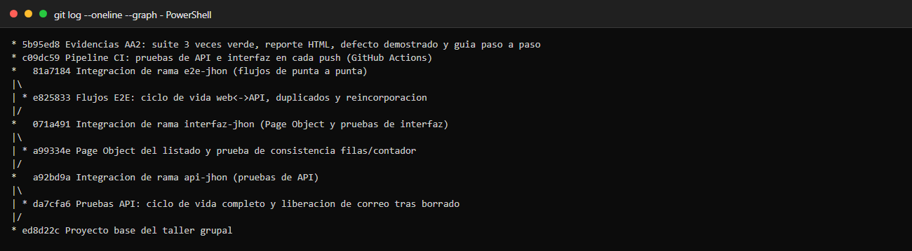

*Captura 2. Historial de commits con las tres ramas integradas en main (`git log --oneline --graph`).*

Regla aplicada durante el trabajo: **cada quien edita solo sus archivos** y
`tests/conftest.py` no se modifica sin avisar al equipo.

### 4.5 Pipeline de integración continua (opcional, Paso 6.3)

`.github/workflows/pruebas.yml` ejecuta `-m api` y luego `-m ui` (interfaz +
flujos) en cada `push`/`pull_request` y sube `reportes/` y `evidencias/` como
artefacto. Queda listo para activarse al publicar el repositorio en GitHub
(con captura de la pestaña Actions en verde una vez haya un remoto).

### 4.6 Ejecutar la suite completa tres veces seguidas (Paso 6.2)

```bash
python -m pytest -v                                                     # corrida 1
python -m pytest -v                                                     # corrida 2
python -m pytest -v --html=reportes/reporte.html --self-contained-html   # corrida 3 + reporte
```

Salidas completas en `capturas/04_ejecucion_1_de_3.txt`,
`capturas/05_ejecucion_2_de_3.txt` y `capturas/06_ejecucion_3_de_3_con_reporte.txt`.

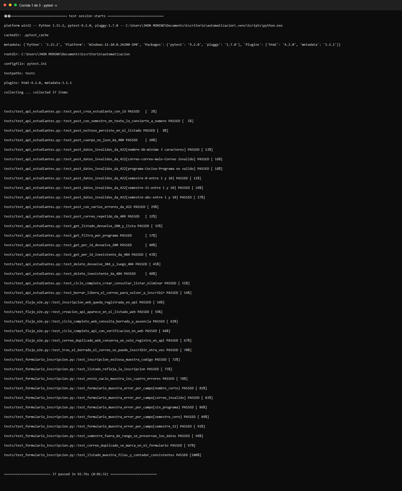

*Captura 3. Corrida 1 de 3: suite completa en verde.*


*Captura 4. Corrida 2 de 3: suite completa en verde.*

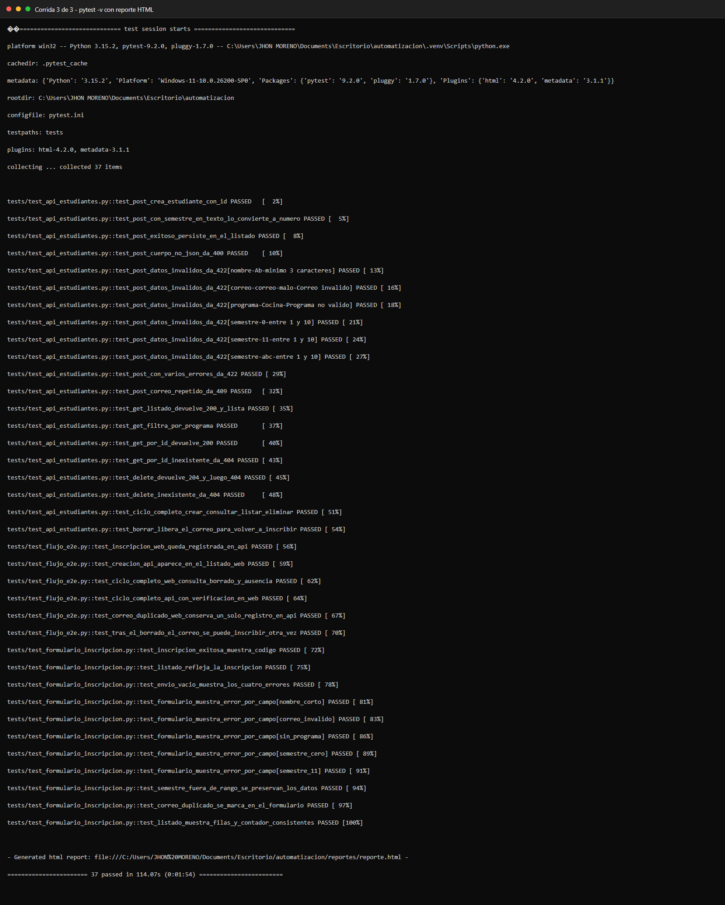

*Captura 5. Corrida 3 de 3 con reporte HTML generado.*

### 4.7 Demostración del defecto (prueba de la prueba)

Se introdujo a propósito un defecto en `app/servidor.py`: el `DELETE` devolvía
`204` **sin eliminar** el registro.

```bash
# (editar app/servidor.py: el DELETE deja de hacer estudiantes.pop(...))
python -m pytest -v -k "delete or ciclo or libera or borrado"   # ← falla
git checkout -- app/servidor.py                                  # revertir
python -m pytest -v -k "delete or ciclo or libera or borrado"   # ← vuelve a verde
```


*Captura 6. Defecto introducido: 6 pruebas fallan (API y flujos E2E).*

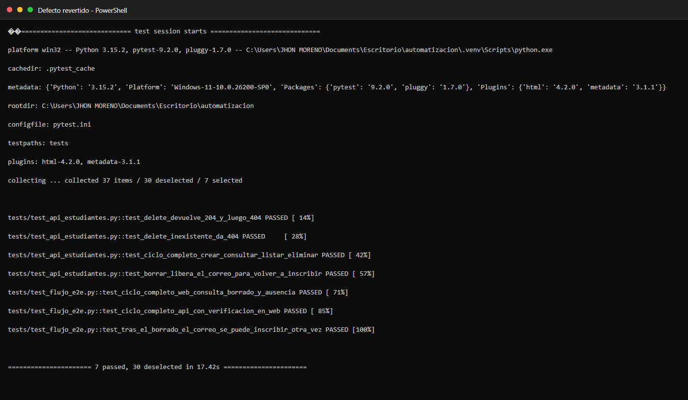

*Captura 7. Defecto revertido: las mismas pruebas vuelven a pasar.*

### 4.8 Recolectar evidencias (Paso 7)

| Evidencia | Dónde está |
|---|---|
| Código | Este repositorio (sin `.venv`; exportable con `git archive`) |
| Ejecución en verde (3 veces) | `capturas/04…06_ejecucion_*.txt` + `.png` |
| Reporte HTML | `reportes/reporte.html` (autocontenido) |
| Capturas del navegador | `evidencias/` (fixture `evidencia(...)`, incluye los 6 flujos E2E) |
| Defecto detectado | `capturas/07_defecto_introducido.txt` y `capturas/08_defecto_revertido.txt` |
| Trabajo colaborativo | `capturas/09_historial_git.txt` (historial con ramas y merges) |
| Demostración en vivo | `capturas/demo_01…demo_05.jpg` (flujo E2E-03 ejecutado a mano, sección 4.10) |
| Pipeline | `.github/workflows/pruebas.yml` |

### 4.9 Generar este documento en HTML

```bash
python tools/md_a_html.py GUIA_AA2.md GUIA_AA2.html
```

### 4.10 Demostración en vivo del flujo E2E-03 (capturas del navegador)

El mismo flujo que automatiza `test_ciclo_completo_web_consulta_borrado_y_ausencia`
se ejecutó **a mano en el navegador** contra el servidor corriendo en
`http://127.0.0.1:5000`, dejando captura de cada etapa:

**① Inscribir por el formulario → mensaje de éxito con el código**

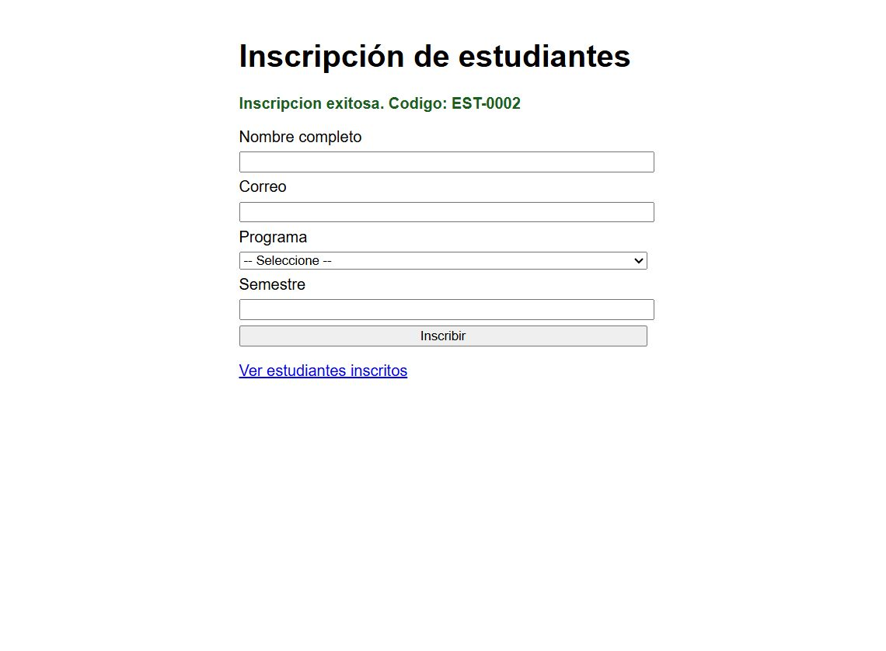

*Demo 1. Formulario enviado: "Inscripcion exitosa. Codigo: EST-0002".*

**② Verificar en la API que el dato quedó guardado**

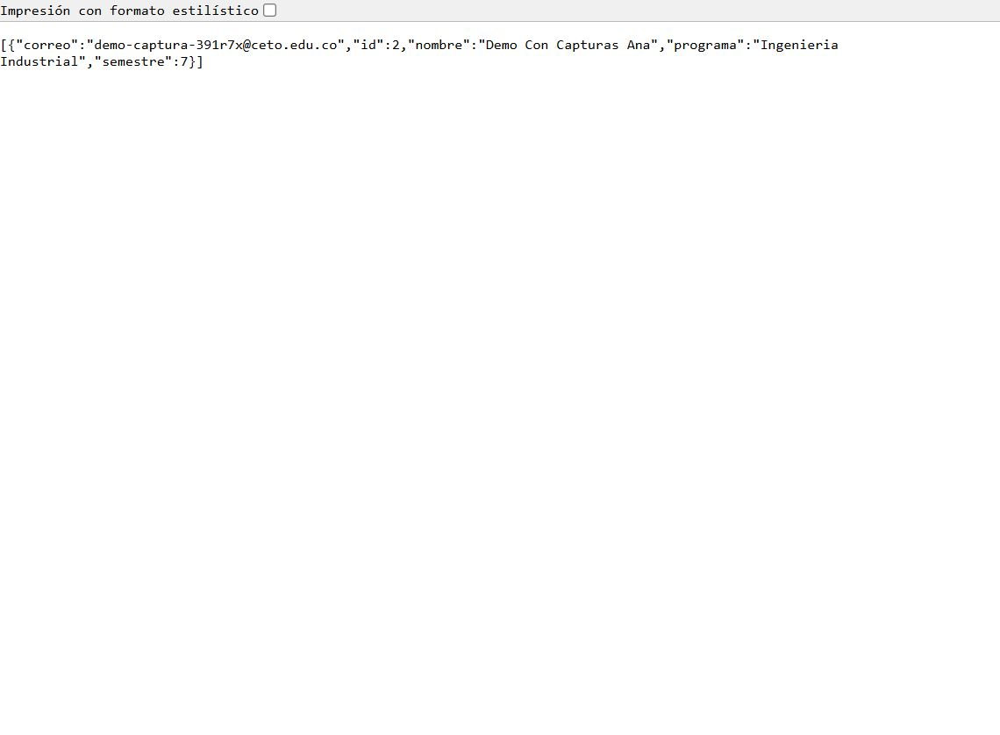

*Demo 2. `GET /api/estudiantes` devuelve el registro `id: 2` con nombre, correo, programa y semestre idénticos a los del formulario.*

**③ Confirmar la fila en el listado web (antes de borrar)**

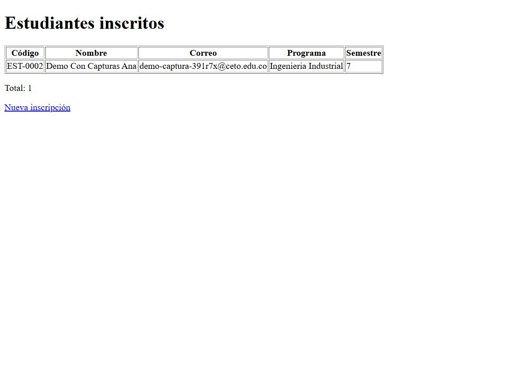

*Demo 3. Listado `/estudiantes`: fila `EST-0002` y `Total: 1`.*

**④ Eliminar por la API y comprobar el 404**

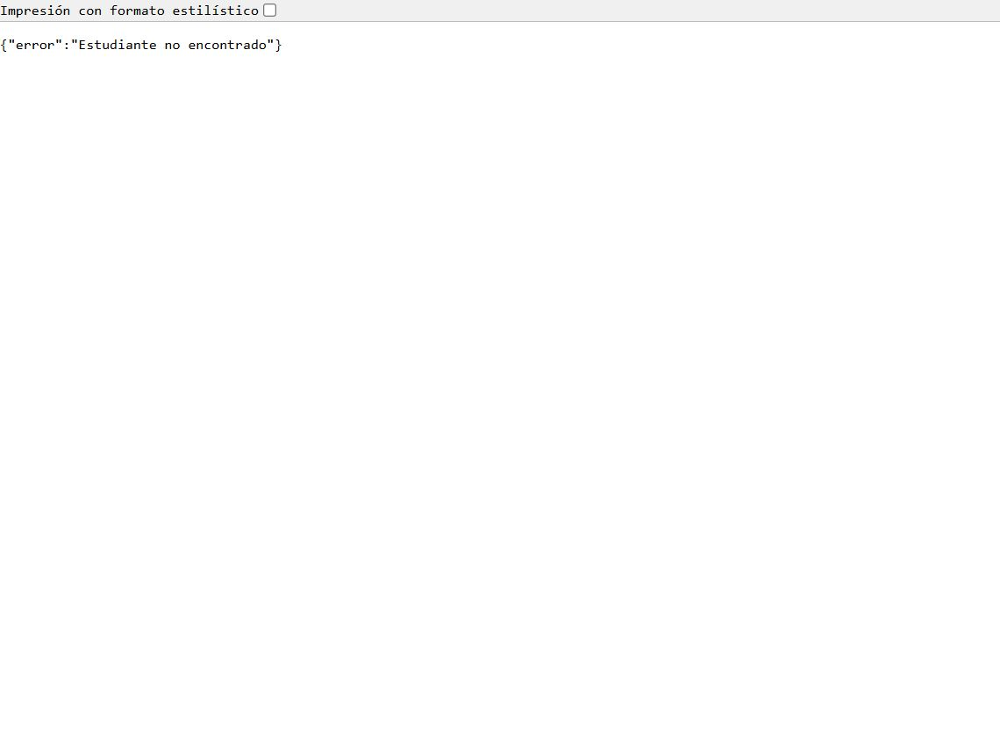

*Demo 4. `DELETE` → `204` y después `GET /api/estudiantes/2` → `{"error":"Estudiante no encontrado"}`.*

**⑤ Verificar en la web que el registro ya no existe**

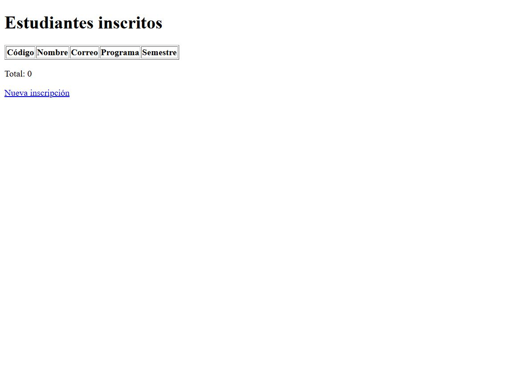

*Demo 5. Listado recargado: tabla sin filas y `Total: 0` — la ausencia confirmada en la capa web.*

| Etapa del flujo | Captura |
|---|---|
| Crear (web) | `capturas/demo_01_formulario_exito.jpg` |
| Consultar (API) | `capturas/demo_02_api_con_registro.jpg` |
| Listar (web) | `capturas/demo_03_listado_antes_de_borrar.jpg` |
| Eliminar (API) | `capturas/demo_04_api_404_tras_borrar.jpg` |
| Verificar ausencia (ambas capas) | `capturas/demo_05_listado_tras_borrar.jpg` |

---

## 5. Los scripts explicados

### 5.1 Fixtures compartidas (`tests/conftest.py`, intocable)

`base_url` levanta la app en un hilo y **un puerto libre** una vez por sesión;
`api_url` deriva de ella; `driver` abre Chrome headless y siempre cierra con
`quit()`; `evidencia('nombre')` guarda PNG en `evidencias/` y el hook
`pytest_runtest_makereport` captura automáticamente la pantalla **si una prueba
falla**. Ninguna prueba necesita tener el servidor abierto a mano.

### 5.2 Page Objects: uno por página, compartido por todos

`pages/inscripcion_page.py` (formulario) centraliza localizadores y acciones;
`pages/listado_page.py` (listado) hace lo propio con la tabla. Las pruebas solo
dicen **qué** verificar; los Page Objects informan **cómo** se maneja el HTML,
y **nunca** contienen `assert`.

Lo más importante para el Foco 1 es la espera del borrado: el navegador debe
recargar `/estudiantes` y solo entonces comprobar que la fila desapareció —
nunca una lectura al azar ni un `sleep`:

```python
def esperar_que_no_haya_fila_con(self, texto, tiempo=8):
    """Espera a que desaparezca toda fila que mencione el texto."""
    WebDriverWait(self.driver, tiempo).until(
        lambda d: not any(texto in f.text for f in d.find_elements(*self.FILAS))
    )
    return self
```

### 5.3 Pruebas de la API: Arrange → Act → Assert con limpieza

El caso bandera de la capa API recorre el ciclo de vida completo en una sola
prueba y verifica el **efecto** de cada paso (incluida la ausencia tras el
borrado):

```python
def test_ciclo_completo_crear_consultar_listar_eliminar(api_url):
    """Foco 1: crear -> consultar -> listar -> eliminar -> verificar ausencia."""
    creada = crear(api_url, nombre="Ciclo De Vida Prueba")
    assert creada.status_code == 201
    id_est = creada.json()["id"]

    detalle = requests.get(f"{api_url}/{id_est}", timeout=10)
    assert detalle.status_code == 200
    assert detalle.json() == creada.json(), "la consulta debe ser consistente con la creacion"

    assert any(e["id"] == id_est for e in requests.get(api_url, timeout=10).json())

    assert requests.delete(f"{api_url}/{id_est}", timeout=10).status_code == 204

    assert requests.get(f"{api_url}/{id_est}", timeout=10).status_code == 404
    assert not any(e["id"] == id_est for e in requests.get(api_url, timeout=10).json())
```

Cada prueba crea sus datos con `uuid` y limpia con `borrar_si_existe()`: la
suite puede correr en cualquier orden sin ensuciarse.

### 5.4 Flujos de punta a punta (`tests/test_flujo_e2e.py`)

El ejemplo resumen del equipo — la inscripción hecha **en el navegador** debe
existir **en la API** con los mismos valores:

```python
def test_inscripcion_web_queda_registrada_en_api(driver, base_url, api_url, evidencia):
    """E2E-01: inscribo por el FORMULARIO -> lo encuentro en la API."""
    correo = correo_unico()

    _, mensaje = inscribir_por_web(
        driver, base_url,
        nombre="Sofia Mejia Rojas", correo=correo,
        programa="Ingenieria Industrial", semestre=7,
        evidencia=evidencia, paso="01_formulario_enviado",
    )
    assert "Inscripcion exitosa" in mensaje, "el formulario debe reportar exito"

    registro = buscar_por_correo(api_url, correo)
    assert registro is not None, "La inscripcion web no aparece en la API"
    assert registro["nombre"] == "Sofia Mejia Rojas"
    assert registro["programa"] == "Ingenieria Industrial"
    assert registro["semestre"] == 7, "el semestre debe persistir igual en la API"
    borrar_si_existe(api_url, registro["id"])
```

Y el caso bandera E2E-03, que encadena **las cuatro etapas del foco 1** cruzando
capas (el código `EST-XXXX` del formulario se convierte en el id que consulta y
borra la API, y la web confirma la ausencia):

```python
    # 1) Crear por el formulario y capturar el codigo EST-XXXX del exito
    _, mensaje = inscribir_por_web(driver, base_url, nombre="Camilo Andres Vera",
                                   correo=correo, programa="Ingenieria de Sistemas",
                                   semestre=9, evidencia=evidencia, paso="03_exito_web")
    id_est = int(re.search(r"EST-(\d+)", mensaje).group(1))

    # 2) Consultar por la API con el id derivado del codigo
    detalle = requests.get(f"{api_url}/{id_est}", timeout=10)
    assert detalle.status_code == 200
    assert detalle.json()["correo"] == correo

    # 3) Listar en la web: el registro aparece en la tabla
    listado = PaginaListado(driver, base_url).abrir().esperar_fila_con(correo)
    assert f"EST-{id_est:04d}" in listado.codigos()

    # 4) Eliminar por la API
    assert requests.delete(f"{api_url}/{id_est}", timeout=10).status_code == 204

    # 5) Verificar la ausencia en AMBAS capas
    assert requests.get(f"{api_url}/{id_est}", timeout=10).status_code == 404
    assert buscar_por_correo(api_url, correo) is None

    listado_final = PaginaListado(driver, base_url).abrir()
    listado_final.esperar_que_no_haya_fila_con(correo)
    assert not listado_final.contiene(correo)
```

**Por qué importa:** una prueba de formulario aislada solo comprueba que
*aparece un mensaje*; un flujo de punta a punta comprueba que **el dato
realmente quedó guardado, es consultable, se lista y, al borrarlo, desaparece
en todas las capas**. Esa es la diferencia entre "la pantalla dice éxito" y
"el sistema funciona".

### 5.5 Datos de prueba externos (`data/casos_formulario.csv`)

Los casos de error de la interfaz no están en el código: son filas del CSV.
**Agregar un caso es agregar una fila**, sin tocar ningún script, y aparece en
el reporte como `test_formulario_muestra_error_por_campo[semestre_11]`.

---

## 6. Resultados

### 6.1 Suite completa — 3 ejecuciones consecutivas

| Corrida | Comando | Aprobadas | Fallidas | Duración | Evidencia |
|---|---|---|---|---|---|
| 1 | `python -m pytest -v` | 37 | 0 | 92.76 s | `capturas/04_ejecucion_1_de_3.txt` + `.png` |
| 2 | `python -m pytest -v` | 37 | 0 | 91.37 s | `capturas/05_ejecucion_2_de_3.txt` + `.png` |
| 3 | `python -m pytest -v --html=…` | 37 | 0 | 114.07 s | `capturas/06_ejecucion_3_de_3_con_reporte.txt` + `.png` |

### 6.2 Resumen por capa

| Capa | Marca | Pruebas | Resultado |
|---|---|---|---|
| API REST | `api` | 20 | 20 aprobadas |
| Interfaz (formulario + listado) | `ui` (sin E2E) | 11 | 11 aprobadas |
| Flujos punta a punta | `e2e` (+`ui`) | 6 | 6 aprobadas |
| **Total** | | **37** | **37 aprobadas · 0 fallidas (3/3 corridas)** |

Reporte HTML: **`reportes/reporte.html`** (autocontenido, se abre en cualquier
navegador).

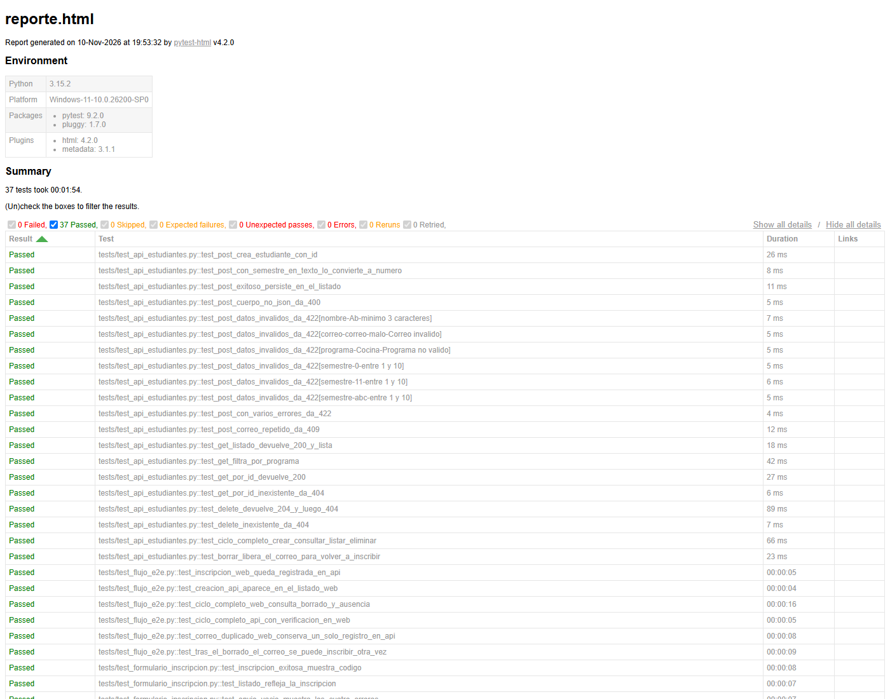

*Captura 8. Reporte HTML de pytest con las 37 pruebas en verde.*

Capturas del navegador en `evidencias/`, por ejemplo:
`test_ciclo_completo_web_consulta_borrado_y_ausencia__04_listado_antes_de_borrar.png`
y `…__05_listado_tras_borrar.png` (el antes y el después del borrado),
`test_correo_duplicado_web_conserva_un_solo_registro_en_api__08_error_duplicado_web.png`
y `test_tras_el_borrado_el_correo_se_puede_inscribir_otra_vez__09_reinscripcion_tras_borrado.png`.

### 6.3 Prueba de la prueba (defecto introducido)

| Escenario | Resultado | Evidencia |
|---|---|---|
| Defecto: `DELETE` responde 204 sin eliminar | **6 fallidas, 1 aprobada** (API-17, API-19, API-20, E2E-03, E2E-04, E2E-06) | `capturas/07_defecto_introducido.txt` + `.png` |
| Defecto presente, ejecutando **solo** las pruebas de formulario | **11 aprobadas, 0 fallidas** — la capa de interfaz **no** lo detecta | `capturas/10_defecto_solo_lo_detectan_api_y_e2e.txt` + `.png` |
| Defecto revertido (`git checkout -- app/servidor.py`) | **7 aprobadas, 0 fallidas** (mismo filtro que la primera fila) | `capturas/08_defecto_revertido.txt` + `.png` |

---

## 7. Hallazgos

### 7.1 Defecto real detectado por la suite (evidencia obligatoria)

**Defecto:** `DELETE /api/estudiantes/<id>` devolvía `204 Not Found` pero **no
eliminaba** el registro (se comparaba el id sin sacarlo del diccionario).

**Cómo se detectó:** con el defecto presente, **6 pruebas cayeron**: las de la
API verificaban el 404 posterior y la liberación del correo; los flujos E2E
detectaron además el **efecto visible**: el estudiante seguía apareciendo en el
listado web después de "borrarlo". Se revirtió el cambio y la suite volvió a
verde. Salidas completas en `capturas/07_defecto_introducido.txt` y
`capturas/08_defecto_revertido.txt`.

**Lección de equipo:** el defecto lo detectaron las capas API y E2E, **jamás
las pruebas de formulario**: ejecutando solo `tests/test_formulario_inscripcion.py`
con el defecto puesto, las **11 pruebas pasaron igual**
(`capturas/10_defecto_solo_lo_detectan_api_y_e2e.txt`) porque el formulario
nunca borra. Cada capa aporta una red distinta y solo cruzándolas se ve el
efecto completo (ver reflexión, pregunta 1).

### 7.2 Sincronización con el navegador: dos errores propios corregidos

1. **Leer la API antes de tiempo (condición de carrera).** En un primer borrador
   de E2E-06 se consultaba la API justo después del clic en *Inscribir*; como el
   POST tarda ~0,5 s, la lectura podía llegar **antes** de que el servidor
   guardara y la prueba fallaba de forma intermitente. Corrección: siempre
   **esperar el mensaje de éxito en el navegador** (`esperar_mensaje_exito()`)
   antes de verificar por API — la señal de que el POST terminó.
2. **Mensaje perdido por recargar la página.** Al crear una segunda instancia de
   `PaginaInscripcion` (que navega en el constructor) justo después del primer
   envío, se perdía el `#mensaje-exito`. Corrección: reutilizar la misma
   instancia para esperar el resultado y solo después abrir una página nueva.

Con esas dos reglas, la suite completa pasó **3 de 3 corridas consecutivas sin
ninguna prueba intermitente**. *Como referencia de curso, el taller documenta
también el caso clásico `Node with given id does not belong to the document`:
se resuelve indicando a la espera que tolere ese error transitorio con
`WebDriverWait(..., ignored_exceptions=(WebDriverException,))` — patrón a
aplicar si algún día aparece un error de nodo obsoleto en nuestras esperas.*

### 7.3 Datos aislados entre pruebas

Cada prueba usa correos únicos con `uuid` y limpia lo que crea. Sin eso, las
pruebas de duplicados (API-12, WEB-10, E2E-05) se contaminarían entre sí y
dependerían del orden de ejecución.

---

## 8. Reflexión grupal

*Reflexión del integrante que asumió los cuatro roles del equipo.*

**1. ¿Qué aportó cada capa de pruebas (API, formulario, punta a punta)? ¿Hubo
algún error que solo detectó una de ellas?**

La **API** da velocidad y precisión: 20 casos en ~2 s que verifican códigos de
estado, contratos y límites. El **formulario** valida lo que el usuario realmente
ve: mensajes por campo, preservación de datos y navegación al listado. Los
flujos **punta a punta** son los únicos que responden *"¿el dato quedó
guardado?"* en lugar de *"¿la pantalla dijo éxito?"*. El defecto demostrado lo
detectaron solo API y E2E —nunca las pruebas puras de formulario—, y los E2E
fueron los que añadieron la consecuencia **visible** (la fila seguía en el
listado tras el borrado). También lo detectaron que solo una capa: WEB-11
(filas vs. `#total`) solo mira la interfaz, y API-04 (cuerpo no JSON) solo
existe en la capa de servicio.

**2. ¿Qué dificultades tuvieron al integrar el trabajo de varias personas en un
mismo proyecto? ¿Cómo las resolvieron?**

Aunque trabajé como equipo reducido, la disciplina de integración fue la misma
que pide el documento: **una rama por responsabilidad** (`api-jhon`,
`interfaz-jhon`, `e2e-jhon`), archivos con dueño claro y `conftest.py`
intocable. La dificultad real fue la **dependencia cruzada**: los flujos E2E
necesitaban el Page Object del listado, que aún no existía en su rama. Se resolvió
integrando en orden (`api` → `interfaz` → `e2e`) con `--no-ff` para que el
historial muestre qué aportó cada rama y el `main` siempre quedara ejecutable.

**3. ¿Encontraron pruebas intermitentes? ¿Qué aprendieron sobre la sincronización
con el navegador?**

Sí, en el desarrollo: la lectura de la API tras el clic (carrera de 0,5 s) y la
pérdida del mensaje al recargar la página hicieron fallar pruebas *unas veces y
otras no*. Ambas se corrigieron con esperas explícitas sobre **señales
semánticas** (mensaje de éxito, fila presente/ausente) en lugar de tiempos
fijos: nunca `time.sleep`. Aprendizaje clave: **la espera correcta es esperar
por el estado que la prueba necesita comprobar, no por una cantidad de tiempo**.
Resultado: 3 corridas consecutivas sin un solo flake.

**4. Si este módulo pasara a producción, ¿qué pruebas ejecutarían en cada cambio
y cuáles solo antes de publicar?**

En cada cambio (minutos): las 20 de API y los 6 flujos E2E — son las que
verifican el contrato y la integridad entre capas; corren ~50 s y son las que
más regresiones cuestan en producción. Antes de publicar (pase completo): las 11
de interfaz con capturas y el reporte HTML, más la exploración manual de
usabilidad. El pipeline `.github/workflows/pruebas.yml` ya ejecuta exactamente
esa secuencia en cada `push`.

**5. ¿Qué harían diferente si empezaran de nuevo?**

Escribir los **flujos E2E primero que las pruebas unitarias de capa**: al
definir temprano "crear web → verificar API → borrar → verificar ausencia" se
habrían descubierto antes los huecos (por ejemplo, que hace falta un Page Object
para el listado) y se habría diseñado el `conftest` con ese flujo en mente.
También: generar las capturas y el historial de git **durante** el trabajo, no al
final, y dejar el defecto de demostración anotado en el plan desde el día 1.

---

## 9. Aportes individuales

| Integrante | Rol | Aportes concretos (archivos y pruebas) |
|---|---|---|
| **Jhon Alexis Moreno** | Líder / integrador | `git init`, `.gitignore`, estructura del repo, ramas e integraciones con `--no-ff`, `pytest.ini` con las marcas `api`/`ui`/`e2e`, `.github/workflows/pruebas.yml` (pipeline), ejecución y estabilización de la suite 3 veces |
| Jhon Alexis Moreno | Responsable de API | `tests/test_api_estudiantes.py`: 18 pruebas heredadas de AA1 + **API-19** (ciclo de vida completo) y **API-20** (borrado libera el correo) → 20 pruebas |
| Jhon Alexis Moreno | Responsable de interfaz | `pages/inscripcion_page.py` (Page Object del formulario), `pages/listado_page.py` (Page Object del listado, nuevo), **WEB-11** (filas vs. contador) → 11 pruebas de interfaz |
| Jhon Alexis Moreno | Evidencias y documentación | `tests/test_flujo_e2e.py` (**E2E-01…E2E-06**), demostración del defecto (`capturas/07…08`), reporte `reportes/reporte.html`, capturas de navegador en `evidencias/`, historial `capturas/09_historial_git.*`, esta guía (`GUIA_AA2.md` + `GUIA_AA2.html`) y la reflexión |

> El reparto respeta la regla del taller: **todos escriben pruebas** (cada rol
> aportó pruebas) y la matriz de la sección 3 registra el responsable de cada
> caso.

---

## Lista de verificación AA2

- [x] El plan de pruebas tiene matriz de casos con responsables (37 casos, sección 3.2).
- [x] Hay al menos 3 flujos de punta a punta que cruzan la API y la interfaz (6, sección 3.3).
- [x] Hay un solo Page Object por página, reutilizado por todo el equipo (`inscripcion_page.py`, `listado_page.py`).
- [x] La suite completa pasa **3 veces seguidas** (sección 6.1).
- [x] Hay evidencias de código, capturas, reporte, defecto detectado y trabajo colaborativo (sección 4.8).
- [x] La guía paso a paso es reproducible por otro equipo (sección 4).
- [x] Están la reflexión grupal y la tabla de aportes individuales (secciones 8 y 9).
